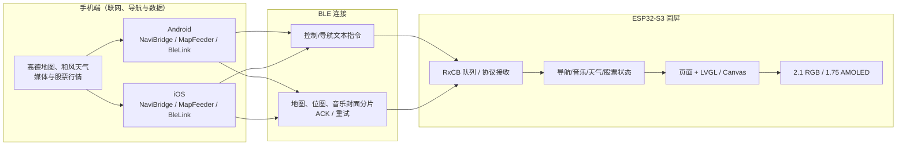

# MotoNav 系统架构（2026-11-09）

本文件记录 **当前仓库已经存在的设计**；对尚未验证的 2.1 功能不作完成承诺。这里重点解释模块边界和开发入口，而不重复每轮历史 Release。

## 1. 系统边界



手机负责定位、路线、地图图像、天气和媒体资料的取得与处理，ESP32 展示收到的信息、读取设备触摸/电量，并返回 ACK 或控制事件。**ESP32 不负责独立算路，也不是第三方 Key 的存储地。**

## 2. 主要目录与责任

| 位置 | 核心职责 | 典型入口 |
| --- | --- | --- |
| `android/app/src/main/java/com/example/motonav/` | Android 页面、导航、地图采集、天气、BLE、音乐和分享 | `MainActivity.kt`, `NaviBridge.kt`, `MapFeeder.kt`, `BleLink.kt` |
| `ios/MotoNav/` | iOS 界面、导航、地图、BLE、媒体和股票数据 | `ContentView.swift`, `NaviBridge.swift`, `MapFeeder.swift`, `BleLink.swift`, `StockBridge.swift` |
| `firmware/boards/21/MotoNav/` | 2.1 实验固件：RGB 硬件、触摸、页面、协议 | `MotoNav.ino`, `Board21Panel.h`, `src/` |
| `firmware/boards/175/MotoNav/` | 1.75 AMOLED 固件 | `MotoNav.ino`, `src/` |
| `firmware/boards/185b/` | 1.85B 实验板型 | 对应固件目录 |
| `firmware/build.py` | 选择板型编译并生成镜像与哈希清单 | `--board 21` / `--board 175` |
| `firmware/tests/`, `android/tests/`, `ios/tests/` | 现有协议/逻辑/平台检查 | 按平台运行相应脚本 |
| `experiments/traffic-lights/` | Android 红绿灯读秒独立实验 | 单独构建、单独验证 |

**版本真值**：Android 版本参照 `android/app/build.gradle.kts`；iOS 源码版本参照 `RELEASE_VERSION`；固件版本参照对应板型 `src/core/FirmwareConfig.h`；成品版本以已存在的 GitHub Release 为准。历史说明不会自动跟随源码更新。

## 3. 2.1 固件数据和显示调用链

```text
BLE characteristic write
  -> src/connectivity/Bluetooth.h : RxCB（边界检查 + 入队）
  -> MotoNav.ino : loop() 按时间片出队
  -> src/protocol/CommandReceiver.h / BulkReceiver.h
  -> 页面状态、地图缓存、文字位图、音乐/行情结构
  -> src/pages/* + src/display/LvglOverlay.h
  -> 466×466 逻辑 Canvas
  -> src/display/DisplayPipeline.h（复制/旋转/局部刷新）
  -> Board21Panel.h / RGB 帧缓冲 / 480×480 实体屏
```

- BLE 消息有控制指令和大块分片（地图、封面等）。分片的完成确认/重传与设备状态必须保持匹配，不能无检查改协议。
- 2.1 当前使用 LVGL 8.3 与原 Canvas 混合渲染；UI 变更、屏幕旋转及地图绘制会影响失效区域和全帧/局部刷新策略。
- 现有 0° 路径可以按区域拷贝；90° 倍数和任意角度使用各自旋转路径，不能假设局部刷新天然适用于旋转画面。
- 输出路径涉及多个缓存、PSRAM 与跨核刷屏任务。以逻辑 466×466 RGB565 计算，**每帧约 424 KiB**；物理 480×480 RGB565 约 **450 KiB**。完整优化前应核实真实分配、复制次数和内存带宽。
- 2.1 实测阶段计时参照 [UI 性能记录](UI-PERFORMANCE-2026-11-08.md)；不同场景测时不等于端到端延迟或固定帧率。

## 4. 硬件与协议兼容边界

| 板型 | 显示与触摸 | 兼容原则 |
| --- | --- | --- |
| 1.75 | 466×466 QSPI AMOLED，CST92xx | 只用 1.75 固件与正确分区 |
| 2.1 | 480×480 RGB（ST7701S）+ CST820 | 2.1 板级适配、独立构建与烧写 |
| 1.85B | 360×360 实验移植 | 禁止使用 1.75 / 2.1 镜像 |

手机端公共导航协议可复用，但**板级初始化、显示驱动和电源感知不能直接复制**。2.1 目前通过 GPIO4 ADC 估算电量，没有已验证的 USB/充电状态测量；自动关机策略将未知供电视作保守状态，相关 UI 状态仍需完善。参考 [板级调研](BOARD-2.1-RESEARCH.md)。

## 5. 新功能应落在哪层

- 新的地图/天气/股票数据源：优先在手机 App 处理认证、解析、缓存、权限；BLE 只发送显示所需的最小数据。
- 新的 2.1 页面、主题、触摸：优先在对应 `src/pages`、`LvglOverlay.h` 或板级触摸实现，别同时改 1.75。
- 新的 BLE 消息类型：先定义报文、版本协商、长度上限、ACK、失败/丢包表现，再改手机端和固件并补测试。
- 性能优化：先用 [代码审查](CODE-REVIEW-2026-11-09.md) 和 [性能基线](UI-PERFORMANCE-2026-11-08.md) 确定瓶颈，保持实车导航可靠性优先于视觉帧率。

## 6. 运行与验证边界

核心构建命令、权限/凭据约定与交付检查见 [AGENTS.md](../AGENTS.md)。2.1 当前已报告的硬件初始化/烧录结果，不代表完整滑动交互、BLE、导航、供电和全天候道路安全验证完成。

本文件记录架构而非发布承诺；状态和下一步以 [ROADMAP](ROADMAP.md) 为准。
